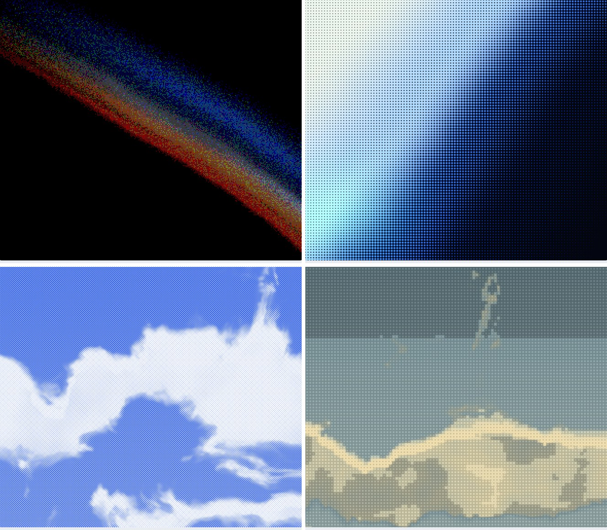

# 網点バックドロップ

写真やグラデーションを、ディザ・網点・二色刷り・モザイクで描き直して、UI の背景の画像にするツールです。描画は WebGL のシェーダー1つで行います。ファイルは `index.html` の1つだけで、ビルドは要りません。

**使う：** https://t-nakatani.github.io/dither-backdrop/

## できること

- **元の絵を選ぶ。** コードで描いた4つの絵（プリズム・青の流れ・積雲・夕方の雲）か、自分の画像を使います。画像は、描画面へのドロップ、貼り付け、ファイルの選択で読み込みます。
- **効果を選ぶ。** 下の4つから選びます。
- **調整する。** 粒の大きさ・コントラスト・明るさ・階調の数・すき間・網の角度・色・元の絵を残す割合を変えます。
- **UI を重ねて見る。** ウィンドウの見本を上に重ねて、背景として使えるかを確かめます。
- **書き出す。** 大きさを選んで PNG を保存します。コピーもできます。
- **コードで使う。** 「シェーダーをコピー」で GLSL を、「設定をコピー」で今の値を JSON で取ります。

## 4つの効果

| 効果 | しくみ |
|---|---|
| ディザ | マスごとに、しきい値をずらして色を数段に減らします。しきい値の並びは、規則（Bayer 8×8）かランダムかを選びます。マスの間にすき間を入れると、LED の画面のような見た目になります。 |
| ドット | マスの中心の明るさで、丸い点の大きさを決めます。点の色は元の絵の色です。 |
| 二色刷り | 網を傾けて、インクと紙の2色だけで刷ります。点の形は、丸・線・ひし形から選びます。 |
| モザイク | 粗いマスに分けて、明るさを5段に分けます。段ごとに、マスの中の小さな四角の形を変えます。 |

## シェーダーを自分のコードで使う

[`backdrop.frag`](backdrop.frag) は、`index.html` の `<script id="frag">` と同じ中身です。WebGL 1 のフラグメントシェーダーで、画面いっぱいの三角形1つに描きます。

| uniform | 型 | 中身 |
|---|---|---|
| `uRes` | vec2 | 描く大きさ（実ピクセル） |
| `uTime` | float | 時間（秒）。元の絵がゆっくり動きます |
| `uSource` | int | 元の絵。0 プリズム、1 青の流れ、2 積雲、3 夕方の雲、4 画像 |
| `uEffect` | int | 効果。0 ディザ、1 ドット、2 二色刷り、3 モザイク |
| `uPattern` | int | ディザのしきい値。0 規則、1 ランダム |
| `uShape` | int | 二色刷りの点の形。0 丸、1 線、2 ひし形 |
| `uTex`, `uTexSize` | sampler2D, vec2 | `uSource = 4` のときの画像とその大きさ |
| `uCell` | float | 粒の大きさ（実ピクセル） |
| `uGap` | float | マスの間のすき間（実ピクセル）。ディザとモザイクで使います |
| `uContrast`, `uBright` | float | 元の絵のコントラストと明るさ |
| `uLevels` | float | 階調の数。ディザとモザイクで使います |
| `uAngle` | float | 二色刷りの網の角度（度） |
| `uMix` | float | 元の絵を残す割合（0〜1） |
| `uInk`, `uPaper` | vec3 | ドットの地の色、二色刷りのインクと紙の色（0〜1） |

粒の大きさとすき間は、実ピクセルで渡します。画面の倍率（`devicePixelRatio`）を掛けると、どの画面でも同じ見た目になります。

## 手元で開く

`index.html` をブラウザで開くだけで動きます。WebGL が使えるブラウザが要ります。

## ライセンス

[MIT](LICENSE)
